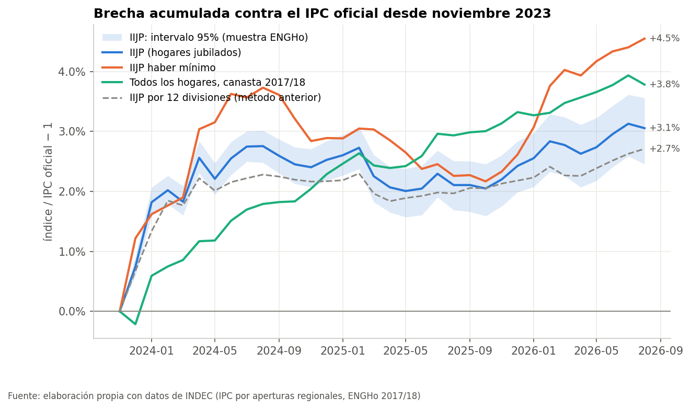
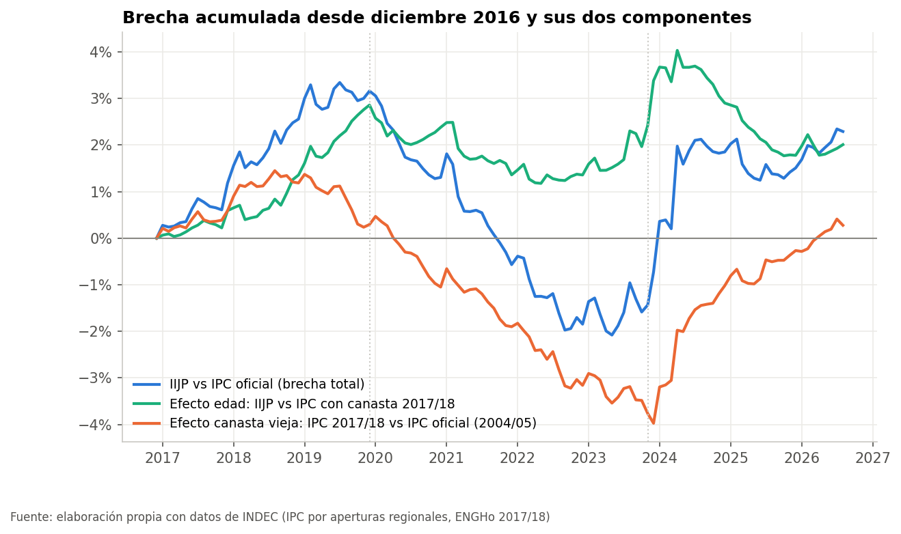
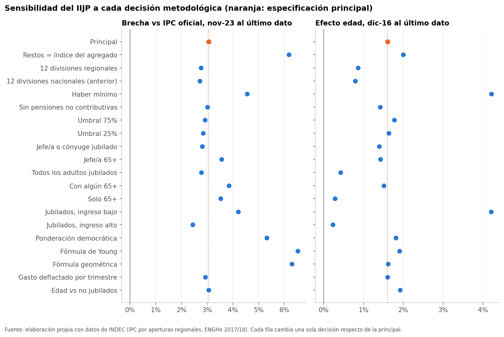
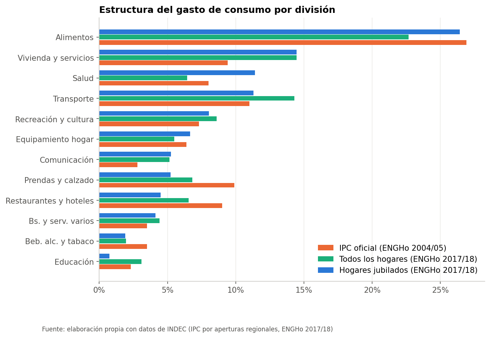
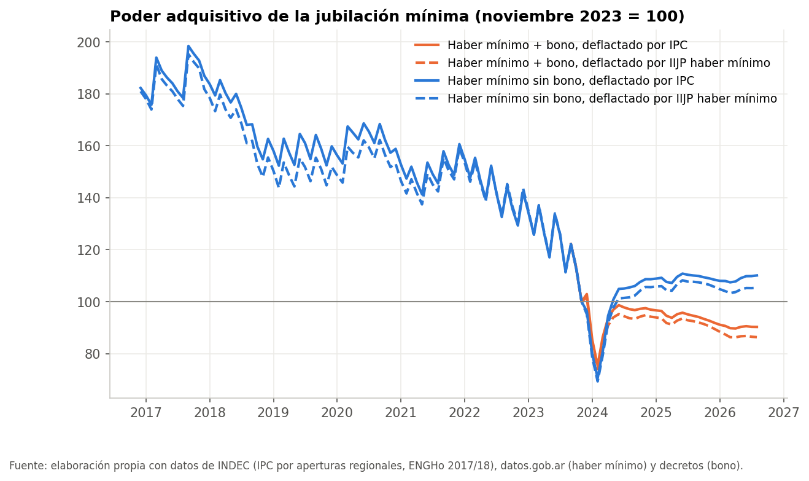
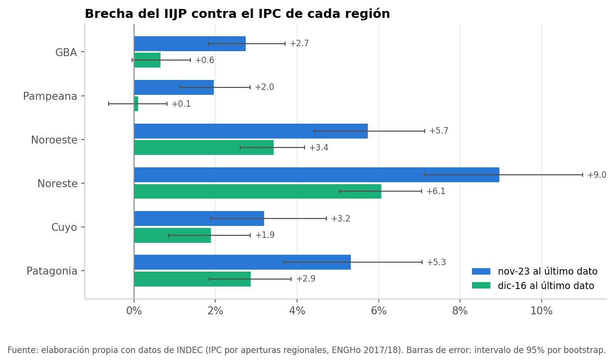
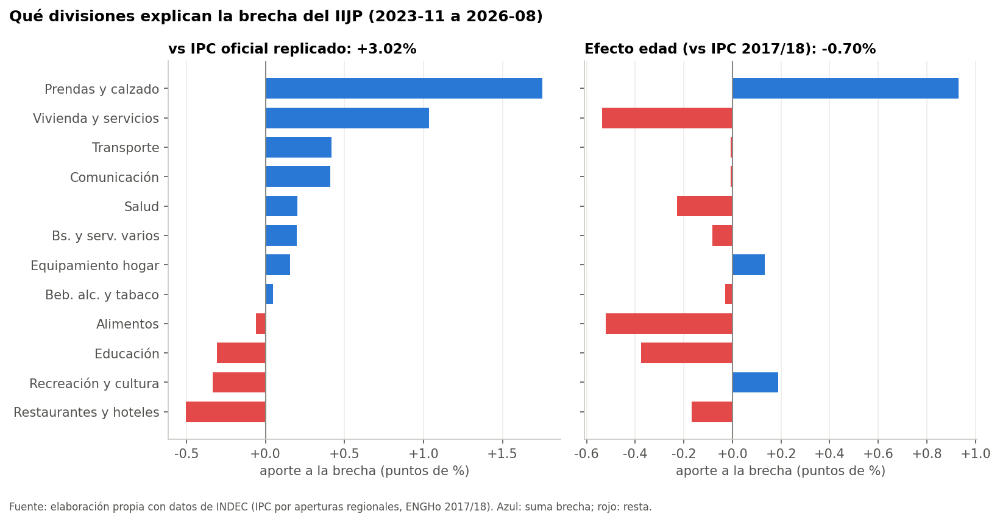

# IIJP · Índice de Inflación de Jubilados y Pensionados

¿La inflación que enfrentan los jubilados es distinta de la que mide el IPC? Este repo construye un
**índice de precios de los hogares jubilados** de la Argentina: valoriza cada mes, con los precios del
IPC del INDEC, la canasta de consumo de los hogares que viven de una jubilación o pensión (microdatos de
la ENGHo 2017/18). La serie es mensual desde diciembre de 2016, se actualiza con cada publicación del
IPC, se compara con el IPC oficial y se usa para medir qué implicaría actualizar los haberes con ella.

El punto de partida fue el trabajo práctico de un grupo de la materia *Medición de la coyuntura y
estructuras económicas* (INECO · UADE); el índice actual es una reconstrucción completa de la
metodología. La revisión del TP original está en [`docs/revision_TP.md`](docs/revision_TP.md).

## Resultados (datos hasta agosto 2026)

| Período | IPC oficial | IIJP | Brecha IIJP vs IPC | Efecto edad | Brecha IIJP haber mínimo vs IPC |
|---|---|---|---|---|---|
| Dic-2016 → ago-2026 | 12.177% | 12.458% | **+2,3%** | **+2,0%** | +4,4% |
| Macri (dic-16 → dic-19) | 183,4% | 192,4% | +3,2% | +2,9% | +4,4% |
| Fernández (dic-19 → nov-23) | 893,5% | 849,3% | −4,5% | −0,4% | −4,8% |
| Milei (nov-23 → ago-26) | 336,0% | 352,4% | **+3,8%** | −0,4% | +5,0% |
| Desde 2025 (dic-24 → ago-26) | 59,6% | 60,3% | +0,4% | −0,9% | +1,6% |

Brecha: (1 + inflación del IIJP) / (1 + inflación del IPC) − 1. Efecto edad: IIJP frente al mismo cálculo
con la canasta de *todos* los hogares de la ENGHo 2017/18.

1. **La canasta de los jubilados es distinta**, entre divisiones y dentro de cada una: más alimentos
   (26,4% vs 22,7% del total de hogares) y salud (11,4% vs 6,4%); dentro de salud, más medicamentos
   (54% vs 42%) y menos prepagas; dentro de vivienda, mucho menos alquiler (14% vs 31%) y más
   electricidad y gas (51% vs 41%); dentro de transporte, más transporte público (27% vs 22%).
2. **Entre 2016 y 2026 el IPC oficial subestimó la inflación de los jubilados en 2,3%** (IC 95%
   muestral: 1,9 a 2,7), y casi todo es efecto propio de la edad (+2,0%). Ambos resultados mantienen el
   signo en las 19 variantes metodológicas. La diferencia no es pareja: cambia de signo según el
   período (−4,5% con las tarifas congeladas de 2019-2023).
3. **Desde noviembre de 2023 la brecha es de +3,8%** (IC 3,2 a 4,3; entre 2,7% y 8,6% según la
   especificación), **pero se explica por la canasta vieja del IPC**: el mismo cálculo con la canasta de
   todos los hogares da +4,2%. En este período el efecto edad es chico (−0,4%) y su signo depende de la
   especificación.
4. **Los jubilados de haber mínimo enfrentaron más inflación**: +4,4% sobre el IPC desde 2016 y +5,0%
   desde noviembre de 2023. Su canasta pesa más alimentos (33%), electricidad y gas, transporte público
   y medicamentos.
5. **Haberes**: frente a noviembre de 2023, el haber mínimo *sin bono* está 10,1% arriba en términos
   reales con el IPC y 4,9% con el IIJP haber mínimo; *con el bono* (congelado en $70.000 desde marzo
   2024) está 9,7% y 14,0% abajo. Indexar por IIJP desde abril de 2024 (misma regla del DNU 274/2024)
   daría un haber 1,95% mayor en septiembre de 2026 ($8.350 por mes en la mínima).
6. **Costo fiscal** de indexar por IIJP desde abril de 2024: 1,2%-1,4% del gasto en jubilaciones y
   pensiones, ~0,07%-0,08% del PIB por año.







| | |
|---|---|
|  |  |
|  |  |

## Cómo usarlo

**En Colab** (no hace falta instalar nada; cada notebook clona el repo, descarga los datos y al
terminar baja a tu computadora un ZIP con el Excel, los gráficos y las tablas en CSV):

| Notebook | Contenido |
|---|---|
| [01 · Canasta de los jubilados](https://colab.research.google.com/github/santiagoriverti/IPC_jubilados/blob/main/notebooks/01_canasta_jubilados.ipynb) | ENGHo 2017/18 → poblaciones, ponderaciones por división y dentro de cada división, peso de las regiones, bootstrap |
| [02 · IIJP vs IPC](https://colab.research.google.com/github/santiagoriverti/IPC_jubilados/blob/main/notebooks/02_iijp_vs_ipc.ipynb) | Estructura de precios, validación, índice, brecha por período, efecto edad vs canasta vieja, regiones, descomposición, tabla de variantes |
| [03 · Haberes y costo fiscal](https://colab.research.google.com/github/santiagoriverti/IPC_jubilados/blob/main/notebooks/03_haberes_y_fiscal.ipynb) | Haber mínimo y bono, poder adquisitivo, contrafactual IIJP, costo fiscal |

**En la PC**:

```bash
pip install -r requirements.txt
python scripts/construir.py            # CSV en data/processed, Excel y gráficos en output/
python scripts/control_calidad.py      # validaciones (0 alertas esperadas)
python -m pytest tests -q
```

`python scripts/construir.py --refrescar` vuelve a descargar todas las fuentes (rutina mensual: ver
[`ESTADO.md`](ESTADO.md)).

## Nota metodológica

**Población.** Hogares jubilados: jubilaciones y pensiones (contributivas y no contributivas) aportan al
menos la mitad del ingreso del hogar (5.350 hogares en la muestra, 2,96 millones expandidos). Subíndice
**haber mínimo**: hogares jubilados en los que ningún perceptor cobra más de 1,1 haberes mínimos del
momento de la entrevista (2.081 hogares, 40% de los hogares jubilados).

**Canasta.** Gasto de consumo de cada hogar en cada artículo de la ENGHo 2017/18 (archivo de gastos),
agregado con el factor de expansión (ponderaciones plutocráticas, como el IPC).

**Estructura de precios.** El IPC se calcula en 6 regiones y se publica, en cada una, por división,
grupo y algunas clases ("aperturas"). Cada gasto se valoriza con el índice más específico publicado en
su región (254 componentes: alquiler, electricidad y gas, medicamentos, prepagas, transporte público,
etc.). La parte de cada agregado sin índice propio publicado (p. ej. agua dentro de Vivienda) se valoriza
con un índice deducido de la estructura oficial de ponderaciones del INDEC: como el IPC agrega con la
fórmula de Laspeyres, I_resto = (W_agregado · I_agregado − Σ W_hijo · I_hijo) / W_resto. Con las
ponderaciones oficiales, esta estructura reproduce el IPC nacional con error máximo de 0,08% desde 2016.

**Índice.** Canasta fija (índice de Lowe): IIJPₜ = Σ qₖ · Iₖ,ₜ con qₖ = gₖ / Īₖ, donde gₖ es el gasto en
el componente k (región × apertura) e Īₖ su índice promedio durante el relevamiento (nov-2017 a
nov-2018). Es el mismo concepto que el IPC: las ponderaciones se actualizan por precios relativos (si un
rubro se abarata, pesa menos). El índice nacional suma las 6 canastas regionales, cada una según el
gasto de sus hogares jubilados. Base diciembre 2016 = 100.

**Comparaciones.** *Efecto edad*: IIJP vs el mismo cálculo con la canasta de todos los hogares de la
ENGHo 2017/18. *Efecto canasta vieja*: ese índice vs el IPC oficial (ENGHo 2004/05). Descomposición por
componente: (ponderación efectiva A − ponderación efectiva B) × (variación del componente − variación
promedio de B) / (1 + variación de B), sumada por división y por apertura.

**Sensibilidad.** 19 variantes que cambian una sola decisión por vez: nivel de detalle (12 divisiones
nacionales o regionales, restos con el índice del agregado), definición de la población (sin pensiones
no contributivas, umbral 25% o 75%, jefe/a o cónyuge jubilado, jefe/a de 65+, hogares con o solo de
mayores de 65, mitades de ingreso, haber mínimo), ponderaciones democráticas, fórmulas de Young y
geométrica, y gasto deflactado por el trimestre de la entrevista. Una conclusión se considera firme si
mantiene el signo en todas.

**Incertidumbre muestral.** 500 réplicas bootstrap de hogares estratificadas por región (la ENGHo
pública no trae las unidades primarias de muestreo: los intervalos son una cota inferior). Test de
brecha persistente: media de la diferencia mensual en logaritmos con error estándar de Newey-West.

**Haberes.** Haber mínimo de datos.gob.ar (serie `58.1_MP_0_M_24`); bono cargado a mano desde los
decretos ([`data/reference/bono_previsional.csv`](data/reference/bono_previsional.csv)). Regla vigente
verificada en los datos: desde mayo 2024 el haber sube la variación del IPC de dos meses antes
(calculada desde los niveles del índice, con 2 decimales). Contrafactual: la misma regla con el IIJP (o
el IIJP haber mínimo) desde abril 2024.

**Costo fiscal.** Gasto en jubilaciones y pensiones contributivas + pensiones no contributivas del
Sector Público Nacional (IMIG de Hacienda, consolidada en el repo
[`cuentas_publicas`](https://github.com/santiagoriverti/cuentas_publicas)) × (haber IIJP / haber IPC − 1).
Cota superior: ese gasto incluye el bono, que no se indexa. PIB nominal de datos.gob.ar.

**Limitaciones.** La canasta es de 2017/18 (no captura cambios de hábitos posteriores). El índice cambia
las ponderaciones pero usa los precios del IPC: no capta precios propios de los jubilados (cobertura de
PAMI en medicamentos, tarifa social del transporte, segmentación de subsidios energéticos por ingreso).
La ENGHo registra gasto de bolsillo (lo que cubre PAMI no entra en la canasta). Las muestras regionales
de hogares jubilados son chicas fuera de GBA y Pampeana.

## Estructura

```
src/            fuentes.py (descargas) · estructura.py (componentes de precios por región y restos)
                ponderaciones.py (ENGHo: poblaciones y canastas) · indices.py · variantes.py (sensibilidad)
                haberes.py · fiscal.py · pipeline.py (corre todo) · graficos.py · exportar.py (Excel, PNG, CSV, ZIP)
scripts/        construir.py · control_calidad.py · comparar_zip.py (ZIP de Colab vs local)
                gen_notebooks.py (genera notebooks/)
notebooks/      01 canasta · 02 IIJP vs IPC · 03 haberes y fiscal (Colab)
data/reference  ponderaciones oficiales del IPC (nacionales y regionales), bono previsional, series del TP
data/processed  resultados en CSV (versionados)
output/         IIJP_resultados.xlsx y graficos/
docs/           revision_TP.md (revisión del TP original)
                informe_indicadores/seccion_iijp.tex (sección del informe INECO "Propuesta de
                Indicadores Económicos"; pendiente de actualizar a la metodología actual)
tests/          tests rápidos con datos sintéticos
```

**Para continuar el proyecto** (otra sesión u otra PC): [`ESTADO.md`](ESTADO.md) tiene el estado, las
cifras vigentes, la rutina mensual y los pasos para una PC nueva; [`CONTEXTO.md`](CONTEXTO.md) las
definiciones, decisiones y trampas; [`CLAUDE.md`](CLAUDE.md) las reglas de trabajo.

## Fuentes

- INDEC: [IPC, series por división, por aperturas y ponderaciones regionales](https://www.indec.gob.ar/indec/web/Nivel4-Tema-3-5-31);
  [Metodología del IPC (2019)](https://www.indec.gob.ar/ftp/cuadros/economia/metodologia_ipc_nacional_2019.pdf);
  [ENGHo 2017/18, bases de microdatos](https://www.indec.gob.ar/indec/web/Institucional-Indec-BasesDeDatos).
- datos.gob.ar: haber mínimo jubilatorio (`58.1_MP_0_M_24`), PIB nominal (`4.4_OGP_2004_T_17`).
- Ministerio de Economía: IMIG (vía [`cuentas_publicas`](https://github.com/santiagoriverti/cuentas_publicas)).
- Boletín Oficial / ANSES: decretos del bono previsional y DNU 274/2024 (movilidad).
